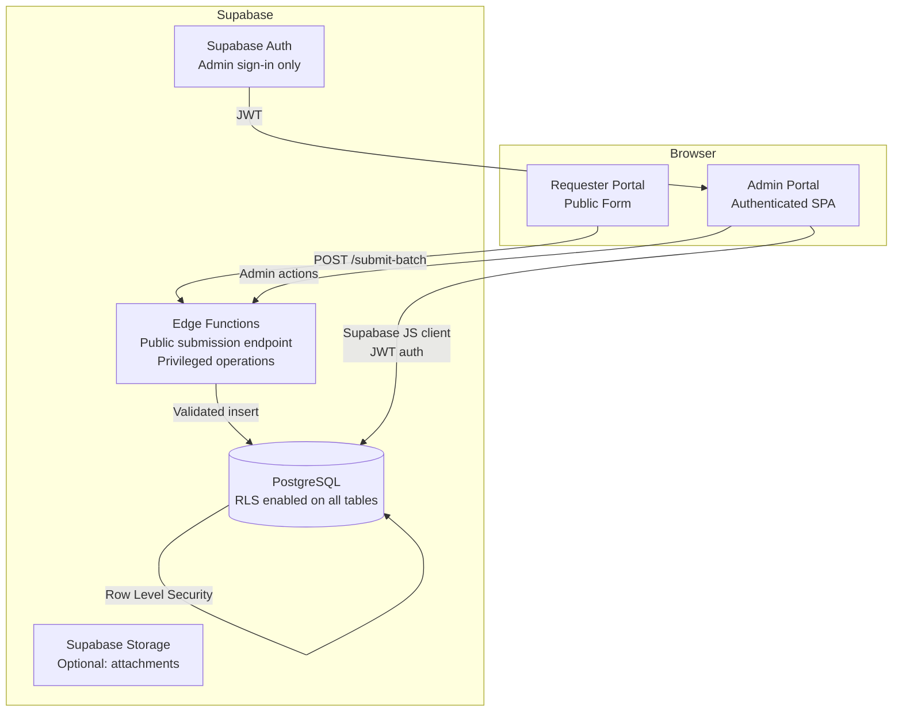
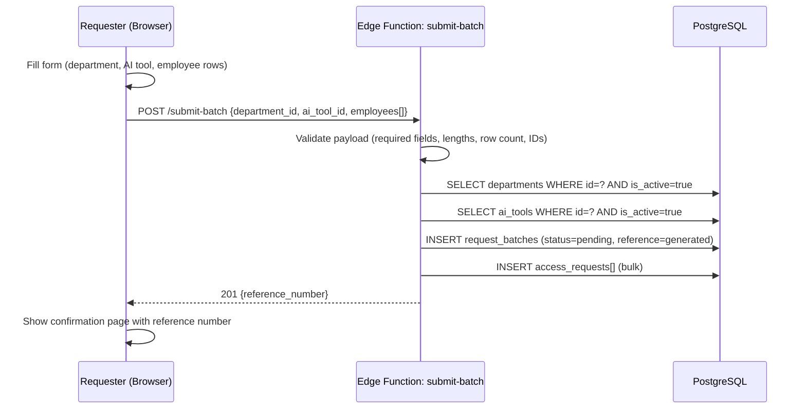
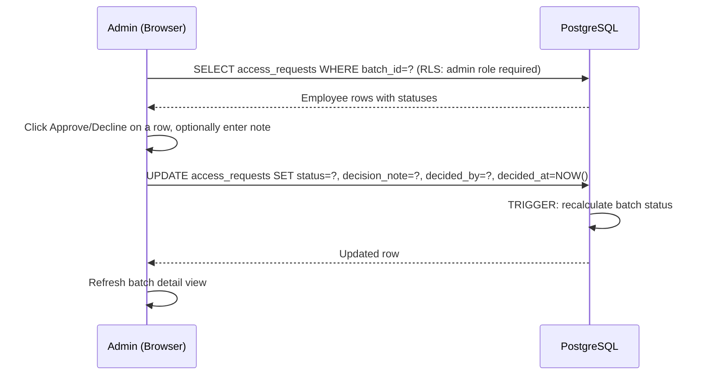
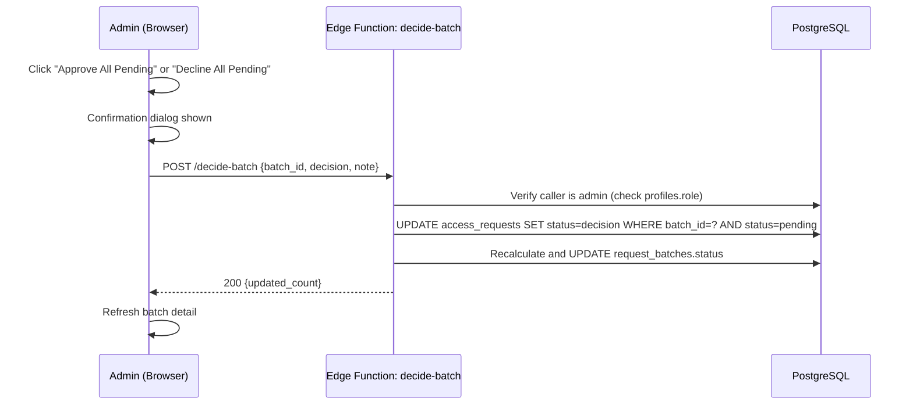
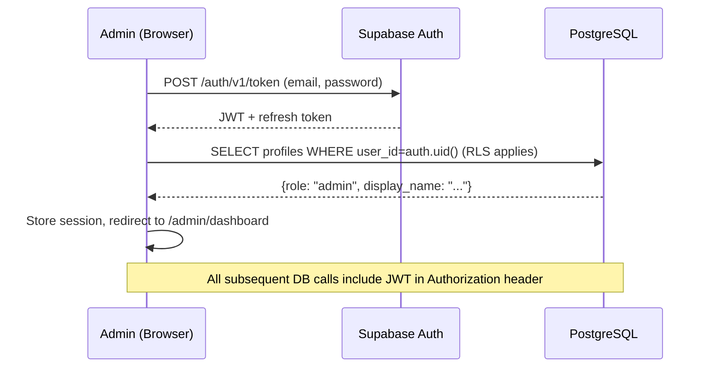
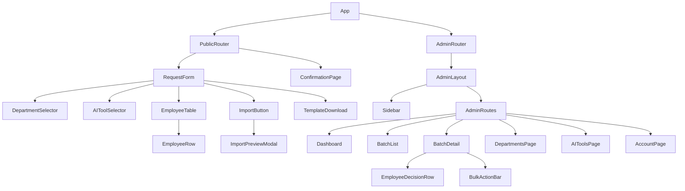
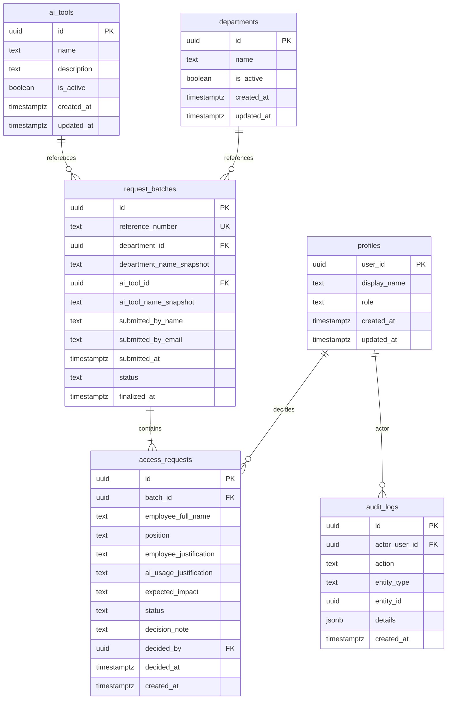
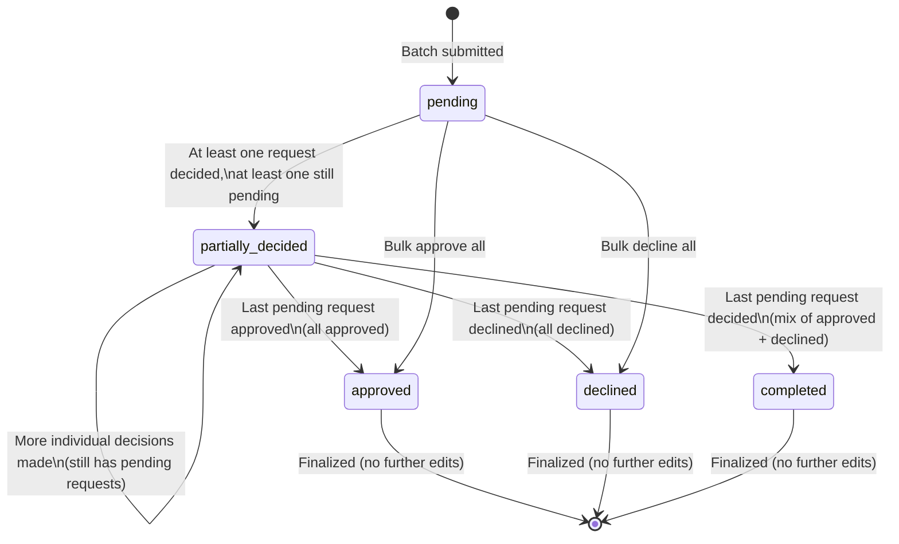
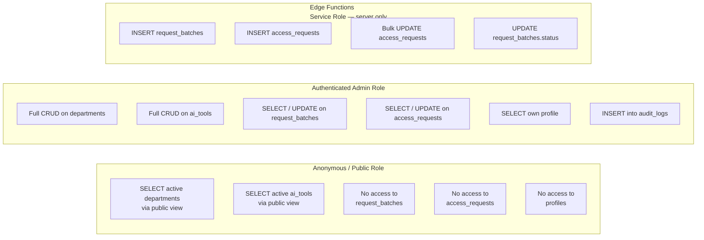

# Design Document: AI Access Request and Approval Portal

## Overview

The AI Access Portal is a web application that enables employees to submit requests for access to AI tools and allows administrators to review, approve, or decline those requests. The system is built on React + TypeScript + Tailwind CSS + shadcn/ui on the frontend, with Supabase (PostgreSQL, Auth, Edge Functions) as the backend.

The portal is split into two distinct surfaces: a fully public requester portal (no login required) where anyone with the URL can submit a batch of employee access requests, and a secured admin portal where authenticated administrators manage submissions, configure reference data, and record decisions. All security enforcement occurs at the database and edge function layer — client-side route protection is a UX convenience only. Actual AI tool provisioning is out of scope.

---

## Architecture



### Key Architectural Decisions

- **No requester accounts**: The public form submits through a narrow Edge Function that validates and inserts — requesters cannot read any data back.
- **Admin auth via Supabase Auth**: Admins sign in with email/password. The JWT is verified server-side by RLS policies and Edge Functions.
- **Edge Functions for privileged writes**: Batch submission and bulk decisions go through Edge Functions that hold the service-role key server-side, never in browser code.
- **RLS on every table**: All tables have Row Level Security enabled. Public `anon` role has no read access to submissions.
- **Name snapshots**: Department and AI tool names are snapshotted at submission time so renames do not corrupt historical records.

---

## System Sequence Diagrams

### Requester — Submit a Batch



### Admin — Approve/Decline Individual Requests



### Admin — Bulk Batch Decision



### Admin — Authentication Flow



---

## Components and Interfaces

### Frontend Component Tree



### Component Interfaces

#### `<RequestForm />`

```typescript
// No props — top-level public page
// Internal state managed via React hooks + React Query

interface FormState {
  departmentId: string | null
  aiToolId: string | null
  employees: EmployeeRowDraft[]
  isSubmitting: boolean
  validationErrors: Record<string, string>
}

interface EmployeeRowDraft {
  id: string // local uuid for keying
  employeeFullName: string
  position: string
  employeeJustification: string
  aiUsageJustification: string
  expectedImpact: string
  errors: Partial<Record<keyof EmployeeRowDraft, string>>
}
```

#### `<ImportPreviewModal />`

```typescript
interface ImportPreviewModalProps {
  open: boolean
  rows: EmployeeRowDraft[]
  validationErrors: RowValidationError[]
  onConfirm: (rows: EmployeeRowDraft[]) => void
  onClose: () => void
}

interface RowValidationError {
  rowIndex: number
  field: string
  message: string
}
```

#### `<EmployeeDecisionRow />`

```typescript
interface EmployeeDecisionRowProps {
  request: AccessRequest
  batchFinalized: boolean
  onDecide: (requestId: string, decision: DecisionStatus, note?: string) => Promise<void>
}

type DecisionStatus = 'approved' | 'declined'
```

#### `<BulkActionBar />`

```typescript
interface BulkActionBarProps {
  batchId: string
  pendingCount: number
  batchFinalized: boolean
  onBulkDecide: (decision: DecisionStatus, note?: string) => Promise<void>
}
```

#### `<DepartmentSelector />` / `<AIToolSelector />`

```typescript
interface SelectorProps {
  value: string | null
  onChange: (id: string) => void
  placeholder: string
  // Items fetched internally via React Query from public-accessible view
}
```

---

## Data Models

### Database Schema



### TypeScript Domain Types

```typescript
// ── Reference Data ────────────────────────────────────────────

interface Department {
  id: string
  name: string
  isActive: boolean
  createdAt: string
  updatedAt: string
}

interface AITool {
  id: string
  name: string
  description: string | null
  isActive: boolean
  createdAt: string
  updatedAt: string
}

// ── Submissions ───────────────────────────────────────────────

type BatchStatus =
  | 'pending'
  | 'partially_decided'
  | 'approved'
  | 'declined'
  | 'completed'

interface RequestBatch {
  id: string
  referenceNumber: string
  departmentId: string
  departmentNameSnapshot: string
  aiToolId: string
  aiToolNameSnapshot: string
  submittedByName: string | null
  submittedByEmail: string | null
  submittedAt: string
  status: BatchStatus
  finalizedAt: string | null
  accessRequests?: AccessRequest[]
}

type RequestStatus = 'pending' | 'approved' | 'declined'

interface AccessRequest {
  id: string
  batchId: string
  employeeFullName: string
  position: string
  employeeJustification: string
  aiUsageJustification: string
  expectedImpact: string
  status: RequestStatus
  decisionNote: string | null
  decidedBy: string | null
  decidedAt: string | null
  createdAt: string
}

// ── Admin ─────────────────────────────────────────────────────

interface Profile {
  userId: string
  displayName: string
  role: 'admin'
  createdAt: string
  updatedAt: string
}

// ── Edge Function Payloads ────────────────────────────────────

interface SubmitBatchPayload {
  departmentId: string
  aiToolId: string
  submittedByName?: string
  submittedByEmail?: string
  employees: {
    employeeFullName: string
    position: string
    employeeJustification: string
    aiUsageJustification: string
    expectedImpact: string
  }[]
}

interface SubmitBatchResponse {
  referenceNumber: string
}

interface DecideBatchPayload {
  batchId: string
  decision: 'approved' | 'declined'
  note?: string
}
```

### Batch Status Transition Rules



---

## Row Level Security Policies



### Policy Descriptions

| Table | Role | Operation | Condition |
|---|---|---|---|
| `departments` | `anon` | SELECT | `is_active = true` (via public view) |
| `departments` | `admin` | ALL | `profiles.role = 'admin'` |
| `ai_tools` | `anon` | SELECT | `is_active = true` (via public view) |
| `ai_tools` | `admin` | ALL | `profiles.role = 'admin'` |
| `request_batches` | `anon` | NONE | — |
| `request_batches` | `admin` | SELECT, UPDATE | `profiles.role = 'admin'` |
| `access_requests` | `anon` | NONE | — |
| `access_requests` | `admin` | SELECT, UPDATE | `profiles.role = 'admin'` |
| `profiles` | `anon` | NONE | — |
| `profiles` | `admin` | SELECT | `user_id = auth.uid()` |
| `audit_logs` | `anon` | NONE | — |
| `audit_logs` | `admin` | SELECT, INSERT | `profiles.role = 'admin'` |

---

## Error Handling

### Public Submission Errors

| Scenario | Response |
|---|---|
| Missing required field | 422 with field-level error map |
| Department/tool ID not found or inactive | 422 "Invalid department or AI tool selection" |
| Employee row count exceeds limit (e.g. 200) | 422 "Too many employee rows" |
| String field exceeds max length | 422 with field name and limit |
| File upload: wrong type / too large | Client-side rejection before submission |
| Duplicate submission (rate limit) | 429 "Too many requests" |
| Internal server error | 500 "Submission failed. Please try again." (no internal details) |

### Admin Errors

| Scenario | Response |
|---|---|
| Unauthenticated request | 401, redirect to /admin/login |
| Authenticated but not admin role | 403 "Insufficient permissions" |
| Attempt to edit finalized batch | 409 "Batch is already finalized" |
| Department/tool name conflict | 422 "Name already exists" |
| Bulk action on empty pending set | 422 "No pending requests to act on" |

---

## Testing Strategy

### Unit Testing Approach

Test pure logic functions in isolation:
- `generateBatchStatus(requests: AccessRequest[]): BatchStatus` — verify all five status outcomes
- `validateEmployeeRow(row: EmployeeRowDraft): RowErrors` — verify each required field, length limits
- `parseImportFile(file: File): Promise<EmployeeRowDraft[]>` — verify CSV and XLSX parsing, formula detection
- `generateReferenceNumber(): string` — verify uniqueness pattern and format

### Property-Based Testing Approach

Use `fast-check` for invariant testing:

**Property Test Library**: fast-check

- For any array of `AccessRequest` values where all statuses are `'approved'`, `getBatchStatus()` must return `'approved'`
- For any array containing at least one `'pending'` status, `getBatchStatus()` must never return a finalized status
- For any valid `SubmitBatchPayload`, the Edge Function must return exactly one `referenceNumber` string
- For any imported file row, `validateEmployeeRow` must never throw — only return an error map

### Integration Testing Approach

- Submit batch via Edge Function and verify `request_batches` and `access_requests` rows are created correctly
- Verify anon role cannot SELECT from `request_batches` or `access_requests`
- Verify admin role can SELECT all batches after authentication
- Verify batch status transitions correctly after individual and bulk decisions
- Verify finalized batch rejects further decision updates

---

## Performance Considerations

- Paginate `request_batches` list (page size 25–50) — avoid full table scans in admin list views
- Index `request_batches(status)`, `request_batches(submitted_at DESC)`, `access_requests(batch_id)`, `access_requests(status)` for common query patterns
- Lazy-load `access_requests` only when a specific batch detail page is opened
- Client-side debounce on search/filter inputs (300ms) to reduce query frequency
- Import preview renders in a virtual list if row count is large (>100 rows)
- Edge Function cold starts are acceptable given the low-frequency public submission path

---

## Security Considerations

- **No service-role key in browser**: All privileged operations go through Edge Functions. The Supabase `anon` key is the only key present in browser bundles.
- **RLS as the primary security boundary**: UI route guards are a UX convenience; all enforcement is at the DB/Edge Function layer.
- **Admin role assignment**: Only via direct SQL `INSERT` into `profiles` by a trusted operator — no public signup path, no self-promotion.
- **CORS restriction**: Edge Functions restrict `Origin` to the known app domain.
- **Rate limiting**: The `submit-batch` Edge Function tracks submission counts per IP using a Supabase table or upstash-redis, rejecting excessive submissions with 429.
- **Input validation**: Edge Functions validate all string lengths, UUIDs, row counts, and enum values before any DB write.
- **XLSX formula injection**: Client rejects any cell beginning with `=`, `+`, `-`, `@` before import preview is shown.
- **File validation**: Accept only `.xlsx` and `.csv` MIME types, max 2MB, max 500 rows.
- **Reference number opacity**: The confirmation page shows the reference number as a courtesy — no public API endpoint accepts a reference number to look up submission details.
- **Audit log**: All admin decisions (individual and bulk) are recorded in `audit_logs` with `actor_user_id`, `action`, and a JSON snapshot of what changed.

---

## Dependencies

| Dependency | Purpose |
|---|---|
| `react` + `react-dom` | UI framework |
| `typescript` | Type safety |
| `tailwindcss` | Utility-first styling |
| `shadcn/ui` | Component primitives (Dialog, Table, Select, Button, Badge, etc.) |
| `@supabase/supabase-js` | Supabase client (auth + data) |
| `@supabase/ssr` | SSR-safe auth helpers |
| `react-router-dom` | Client-side routing |
| `@tanstack/react-query` | Server state management, caching, loading/error states |
| `react-hook-form` | Form state and validation |
| `zod` | Schema validation (client and shared with Edge Functions) |
| `xlsx` (SheetJS `xlsx` package) | Parse `.xlsx` / `.csv` imports; generate downloadable template |
| `fast-check` | Property-based testing |
| `vitest` + `@testing-library/react` | Unit and component testing |
| `deno` (Supabase Edge Functions runtime) | Server-side Edge Function execution |

---

## Page and Route Map

```mermaid
graph LR
    subgraph Public
        P1[/ — Request Form]
        P2[/confirmation — Submission Confirmed]
    end

    subgraph Admin [Admin /admin/*]
        A0[/admin/login — Sign In]
        A1[/admin/dashboard — Dashboard]
        A2[/admin/batches — Batch List]
        A3[/admin/batches/:id — Batch Detail]
        A4[/admin/departments — Departments]
        A5[/admin/ai-tools — AI Tools]
        A6[/admin/account — Account / Logout]
    end

    P1 --> P2
    A0 --> A1
    A1 --> A2
    A2 --> A3
```

---

## Correctness Properties

*A property is a characteristic or behavior that should hold true across all valid executions of a system — essentially, a formal statement about what the system should do. Properties serve as the bridge between human-readable specifications and machine-verifiable correctness guarantees.*

---

### Property 1: All-approved batch status

For any non-empty array of `AccessRequest` values where every request has `status === 'approved'`, `getBatchStatus(requests)` must return `'approved'`.

**Validates: Requirements 9.3**

---

### Property 2: All-declined batch status

For any non-empty array of `AccessRequest` values where every request has `status === 'declined'`, `getBatchStatus(requests)` must return `'declined'`.

**Validates: Requirements 9.4**

---

### Property 3: Pending requests prevent finalized status

For any array of `AccessRequest` values containing at least one entry with `status === 'pending'`, `getBatchStatus(requests)` must never return `'approved'`, `'declined'`, or `'completed'`.

**Validates: Requirements 9.2, 9.3, 9.4, 9.5**

---

### Property 4: Mixed decided with no pending yields completed

For any array of `AccessRequest` values that contains both `'approved'` and `'declined'` statuses and no `'pending'` entries, `getBatchStatus(requests)` must return `'completed'`.

**Validates: Requirements 9.5**

---

### Property 5: Partial decisions yield partially_decided

For any array of `AccessRequest` values where at least one request is `'approved'` or `'declined'` and at least one is `'pending'`, `getBatchStatus(requests)` must return `'partially_decided'`.

**Validates: Requirements 9.2**

---

### Property 6: validateEmployeeRow never throws

For any `EmployeeRowDraft` input (including empty objects, null-like values, or oversized strings), `validateEmployeeRow` must always return an error map and never throw an exception.

**Validates: Requirements 2.8**

---

### Property 7: Empty or whitespace required field always produces a validation error

For any `EmployeeRowDraft` where `employeeFullName`, `position`, `employeeJustification`, `aiUsageJustification`, or `expectedImpact` is an empty string or whitespace-only, `validateEmployeeRow` must return a non-empty error entry for that field.

**Validates: Requirements 2.1, 2.9**

---

### Property 8: Oversized field always produces a validation error

For any `EmployeeRowDraft` field value whose character length exceeds the defined maximum, `validateEmployeeRow` must include an error for that field regardless of the values of other fields.

**Validates: Requirements 2.2, 2.8**

---

### Property 9: Fully valid row produces no errors

For any `EmployeeRowDraft` where all required fields are non-empty and within length limits, `validateEmployeeRow` must return an empty error map.

**Validates: Requirements 2.10**

---

### Property 10: Reference numbers are unique per submission

For any two distinct successful calls to the `submit-batch` Edge Function (even with identical payloads), the returned `referenceNumber` values must differ.

**Validates: Requirements 4.2**

---

### Property 11: Reference number format is stable

For any successful submission, the returned `referenceNumber` must match the defined format pattern (fixed prefix followed by alphanumeric characters of a fixed length).

**Validates: Requirements 4.1**

---

### Property 12: Anonymous role never reads submission or sensitive data

For any query against `request_batches`, `access_requests`, `profiles`, or `audit_logs` using the `anon` role (no JWT), the result set must always be empty regardless of the filter applied.

**Validates: Requirements 10.2, 10.5, 13.4**

---

### Property 13: Finalized batch rejects further decision updates

For any batch with `status` in `{'approved', 'declined', 'completed'}`, any attempt to UPDATE an `access_requests` row belonging to that batch must be rejected and must not silently succeed.

**Validates: Requirements 7.3, 9.6**

---

### Property 14: parseImportFile never throws on well-formed files

For any `.xlsx` or `.csv` file within the accepted size and row limits, `parseImportFile` must resolve (not reject) and return an array of `EmployeeRowDraft` objects.

**Validates: Requirements 3.7**

---

### Property 15: Formula injection is always flagged and excluded from submission

For any imported cell value beginning with `=`, `+`, `-`, or `@`, the import preview must flag that row and the value must never appear in the final submission payload sent to the Submit_Batch_Function.

**Validates: Requirements 3.6**

---

### Property 16: Active-only filtering for public selectors

For any collection of departments or AI tools that includes both active and inactive records, the list returned to the public requester form must contain only records with `is_active = true`.

**Validates: Requirements 1.2, 12.3, 12.6**

---

### Property 17: Name snapshot is recorded at submission time

For any successful batch submission, the `department_name_snapshot` and `ai_tool_name_snapshot` stored on the `request_batches` record must equal the names of the referenced department and AI tool at the moment of insertion, regardless of any subsequent renames.

**Validates: Requirements 1.9**

---

### Property 18: Row count limit is enforced server-side

For any submission payload whose `employees` array length exceeds 200, the Submit_Batch_Function must return HTTP 422 and must not insert any records.

**Validates: Requirements 2.4**

---

### Property 19: Import confirmation includes only validated rows

For any import preview containing a mix of valid and invalid rows, confirming the import must add only the rows that passed all validation checks to the employee table; invalid rows must be excluded.

**Validates: Requirements 3.5**

---

### Property 20: Unauthenticated access to admin routes is redirected

For any admin route (any path under `/admin/*` except `/admin/login`), a request without a valid session must result in a redirect to `/admin/login` and must not render any admin content.

**Validates: Requirements 5.3**

---

### Property 21: Non-admin authenticated access is denied

For any authenticated user whose `profiles.role` is not `'admin'`, any attempt to access an admin-protected resource must be rejected with HTTP 403 and must not return any admin data.

**Validates: Requirements 5.4**

---

### Property 22: Duplicate reference data name is rejected

For any attempt to create a department or AI tool with a name that already exists in the database, the operation must be rejected with the error "Name already exists" and must not insert a duplicate record.

**Validates: Requirements 12.2, 12.5**

---

### Property 23: Rate limiting blocks excessive submissions

For any sequence of submission attempts from the same IP address that exceeds the configured threshold within the defined time window, the Submit_Batch_Function must return HTTP 429 for every attempt beyond the threshold and must not insert records for those attempts.

**Validates: Requirements 11.1**
